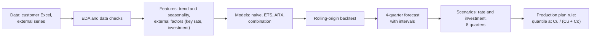

# Russian forklift market forecast (SILANT case)

[Русская версия](README.ru.md)

Quarterly forecast of the Russian forklift market for a factory (SILANT, Chelyabinsk), split into combustion (ICE) and electric trucks. It is a training case from the Netology "Data Scientist: from zero to middle" program. The code, the notebooks and the numbers are mine; the market data come from the case.

## Problem and business meaning

The factory has to plan production and component purchases for the next year. The market dropped sharply in 2025, so the question is: what will it do over the next four quarters, how sure are we, and which number should go into the plan?

What happened in the data (customer file plus the case report):

- 13 quarters, Q1 2023 to Q1 2026, 14 segments (ICE and electric by load capacity).
- Total market fell from 118 to 82 thousand units over 2023-2025 (-30%). In Q2 2025 it dropped by 32% in one quarter (90% CI -44...-17%). The fall is almost entirely ICE (-55%); electric lost 9%.
- Electric share grew from 54% to 72%. The substitution front is trucks of 3-5 t.

## Data

- `data/raw/silant_forklift_market.xlsx` - the customer's Excel file (quarterly sales by type and load-capacity segment). **This is an educational case; the data are small, include no personal data, and are kept here for reproducibility.** File metadata was cleared of the author name.
- `data/external/` - macro series: Bank of Russia key rate, CPI, CNY/RUB, credit, forecasts of the Central Bank and the Ministry of Economic Development; Rosstat figures taken from media (links and dates in `data/external/SOURCES.md`).
- `data/processed/` - all intermediate and result tables produced by the pipeline.

Thirteen quarters is very little. There is one rate cycle and one structural break in the sample, and the notebooks say so at every step.

## Pipeline



## Approach

1. Data checks (totals, anomalies), EDA, trend with a break, seasonality (`notebooks/01`, `02`).
2. External factors: choice by logic first, lags checked on data second (`03`).
3. Models on log seasonally adjusted series: naive, seasonal naive, ETS, ARX on the key rate (lag 2 quarters), and an equal-weight combination of naive + ETS + ARX. Rolling-origin backtest, bootstrap intervals, reconciliation of the segment hierarchy (segments -> type -> market), interval width calibrated on the backtest (`04`).
4. Scenarios on the key rate and investment for 8 quarters, with widening uncertainty layers (`05`, `06`).
5. Comparison with the pretrained Chronos-2 model on the same backtest (`chronos2/`).
6. Plan level rule: the plan is a quantile of demand at alpha = Cu / (Cu + Co), where Cu is the loss from one missing truck and Co the loss from one unsold truck (newsvendor logic). The factory's margins are not in the data, so Cu and Co are parameters.

## Results

Forecast for Q2 2026 - Q1 2027, units over four quarters (median and 80% interval; source: `data/processed/forecast_4q_total.csv`, `forecast_4q_e_share.csv`):

| | Last 4 quarters (fact) | Median | 80% interval |
|---|---|---|---|
| Market | 75,990 | 89,220 | 64,850 - 120,400 |
| ICE | 21,610 | 29,900 | 15,760 - 49,630 |
| Electric | 54,380 | 58,720 | 42,270 - 80,210 |

Electric share of the four-quarter total: fact 71.6%, model median 66.3%, 80% interval 54-79% (printed in notebook 04, section 4: the share of the summed four quarters). The same file `forecast_4q_e_share.csv` holds the share quarter by quarter, and there the P10-P90 range is wider, 0.47-0.83, because single quarters are noisier than the sum.

**Read these numbers with care.**

- On history the model over-forecast the market: by 34% on average, ICE by 65%, electric by 20% (`data/processed/forecast_bias_backtest.csv`). All five backtest origins sit around the Q2 2025 break, which no model could foresee.
- Of the +17% growth in the median, about 9 points are a statistical effect of summing wide distributions and about 6 points come from the expected rate cuts (notebook 04, section 6.3). If sales just stay at the Q1 2026 level, the market is about 77 thousand (+2%).
- So for the plan I recommend the lower part of the interval: 77-84 thousand for the market, ICE around 20-30 thousand. Probabilities of growth in the notebooks are an upper estimate.

Backtest (mean absolute log error, 5 origins, horizon 1-4 quarters; notebook 04 section 6.1 and `chronos2/results/summary_table.csv`; recomputed on 15 October 2026, see the note below):

| Model | Market | ICE | Electric |
|---|---|---|---|
| **Last value, no seasonality (naive baseline)** | **26.3%** | **41.8%** | 19.9% |
| Naive (random walk on seasonally adjusted series) | 33.1% | 53.5% | 23.9% |
| ARX on key rate | 29.2% | 52.8% | 18.3% |
| Combination (chosen for the report) | 29.2% | 50.1% | 19.9% |
| Chronos-2 | 30.0% | 54.0% | 16.4% |
| Chronos-2 + key rate (oracle: uses the actual future rate, optimistic) | 28.3% | 47.8% | 17.4% |

**A simple baseline beats the chosen model.** Repeating the last observed quarter ("last value, no seasonality") has a lower error than the combination on the market (26.3% vs 29.2%) and on ICE (41.8% vs 50.1%); on electric trucks the two are equal (19.9%). That is the honest result on 13 quarters after a structural break: the model that does not wait for a rebound wins. (The "Naive" row differs from this baseline in two ways: it re-applies seasonal factors and it scores the mean of simulated paths, not the last value itself.) The report still uses the combination for a practical reason, not because it is more accurate: it gives intervals for the whole segment hierarchy and it reacts to the key rate, and the rate scenarios need that; a flat last-value line is a point only and has neither. The combination's median for the next four quarters (89 thousand) is well above the flat line (about 77 thousand, if sales stay at the Q1 2026 level). That is why the plan recommendation takes the lower part of the interval and not the median.

Chronos-2 is close to the combination, not clearly better, and on four quarters ahead it gives a much lower forecast: 69.5 thousand (73.3 with the key rate) against 87.4 thousand from the report model (sum of quarterly medians, the way the Chronos notebook compares them). The gap is one more reason not to trust the upper half of the interval. The 80% intervals were too narrow before calibration (68% coverage); after widening them 1.5 times coverage is 84%, but calibration and check use the same five origins, so real coverage is probably lower.

**Correction of 15 October 2026: look-ahead in the key rate.** In the first version of the backtest the ARX model, at every origin, was given the *actual* key rate for the quarters after the origin. With a lag of 2 quarters that affected horizons 3 and 4. Now the rate after the origin is held at the last value known at that origin (persistence); the forecast for the future is unchanged. After the fix: ARX market 29.6% -> 29.2%, ICE 53.8% -> 52.8%, electric 18.4% -> 18.3%; combination market 29.3% -> 29.2%, ICE 50.5% -> 50.1%, electric 19.9% unchanged. So the leak did not inflate ARX; the errors went down slightly (the actual rate was falling while sales were falling too, so knowing it did not help). Horizons 1-2 did not change at all. The interval calibration (k = 1.5) did not change, so the forecast tables above are the same. The Chronos-2 + rate rows could not be recomputed (that needs the model), and they still use the actual future rate: treat them as optimistic. The row "Combination 3 + Chronos-2" in `summary_table.csv` was not recomputed either (its note column says so). Test: `tests/test_core.py::test_backtest_does_not_use_rate_after_origin`.

Other findings:

- +1 pp of the key rate with a 2-quarter lag: about -5.5% ICE sales, -0.8% electric, -2.9% market (one rate episode, so the effect is not statistically proven).
- Rate scenarios for 8 quarters differ little: base case market 87.2 thousand for the first year against 85.5 (conservative) and 87.8 (optimistic). The model uncertainty is many times wider. The real fork is whether ICE comes back, not which rate path is chosen (notebook 05).
- Plan level (from `data/processed/forecast_4q_plan_levels.csv`, market, centre "no change of conditions"): Cu:Co = 1:2 gives 69.9 thousand, 1:1 gives 77.3, 2:1 gives 85.6.
- Decision rule for ICE (case summary, `docs/summary_for_plant_ru.pdf`): if ICE market sales in Q2+Q3 2026 total at most 13.5 thousand (11,000 in 2025), the slump continues; at least 16.0 thousand means recovery; in between, do not change the plan.
- The market is not the factory's demand: the factory's own share is not in the data.

## How to reproduce

```bash
python -m venv .venv && source .venv/bin/activate
pip install -r requirements.txt            # exact versions: requirements-lock.txt
python -m pytest -q tests                  # 14 tests, a few seconds
python update.py                           # recompute all six notebooks, about 2 minutes
python update.py --xlsx new_file.xlsx      # add a new quarter (new column to the right)
```

`update.py` validates the file, regenerates `notebooks/*.ipynb` from `notebooks/build_0X.py`, writes `reports/summary.html` and `reports/silant_forecast.xlsx`. The seed is fixed (42). Notebook outputs in the repo are from the original run of 5 October 2026; notebooks 04 and 05 and the tables that depend on the backtest were recomputed on 15 October 2026 after the fix above. Details (in Russian): `docs/PIPELINE_NOTES.ru.md`. The Chronos-2 notebook needs `pip install chronos-forecasting` and about 1 GB for PyTorch.

The notebooks, charts and tables are in Russian, as the case was.

## Structure

```
src/            data loading, time series, macro, forecast models, scenarios
notebooks/      01 data/EDA, 02 trend/seasonality, 03 factors, 04 forecast, 05 scenarios, 06 long horizon
                (build_0X.py generate the .ipynb files)
chronos2/       Chronos-2 comparison notebook and result tables
data/           raw, external, processed
figures/        key charts
reports/        sample run summary (summary.html) and Excel with the main tables
docs/           one-page summary for the factory (PDF, Russian), pipeline notes
tests/          tests of the core
```


## Limitations

- 13 quarters, one rate cycle, one break: the effect of the rate and investment fits the logic but is not proven statistically.
- The backtest covers only the break period, so accuracy in a calm regime is not measured.
- A last-value forecast is more accurate than the chosen combination in this backtest (see Results); the combination is kept for its intervals and rate scenarios, so use its median with care.
- The Chronos-2 + key rate row is an oracle (actual future rate) and was not recomputed after the backtest fix; it is optimistic.
- Q2 2026 has already passed but is not in the file; the first thing to do is add it with `update.py --xlsx`.
- Q1 2026 may be distorted by the VAT increase and the recycling fee; the aggregates do not show it clearly.
- No margins, costs or the factory's market share: the plan rule needs Cu and Co from the business, and switching production to electric 3-5 t needs a separate economic calculation.
- The Excel working model and the full report from the case are not included here.

License: MIT.
