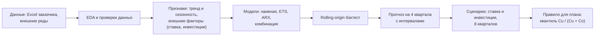
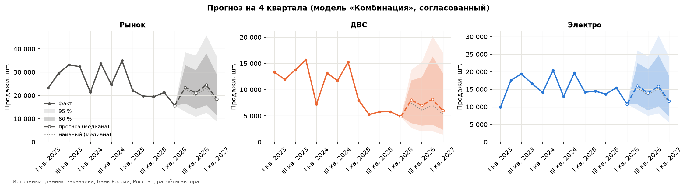
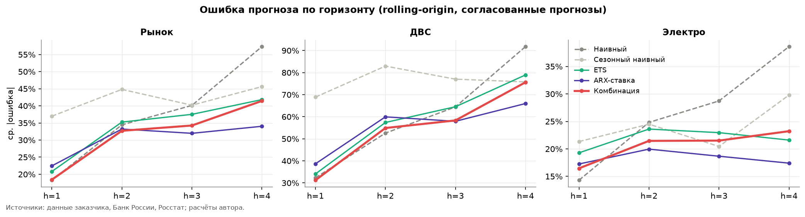

# Прогноз рынка вилочных погрузчиков РФ (кейс СИЛАНТ)

[English version](README.md)

Квартальный прогноз рынка вилочных погрузчиков в России для завода (СИЛАНТ, Челябинск) с разбивкой на ДВС и электро. Это учебный кейс программы Нетологии «Data Scientist: с нуля до middle». Код, ноутбуки и расчёты мои, данные рынка взяты из кейса.

## Задача и бизнес-смысл

Заводу нужно планировать выпуск и закупку комплектующих на год вперёд. В 2025 году рынок резко упал, поэтому вопросы такие: что будет в ближайшие четыре квартала, насколько мы в этом уверены и какое число брать в план.

Что видно в данных (файл заказчика и отчёт по кейсу):

- 13 кварталов, I кв. 2023 - I кв. 2026, 14 сегментов (ДВС и электро по грузоподъёмности).
- Рынок за 2023-2025 годы упал со 118 до 82 тыс. шт. (-30%). Во II кв. 2025 он просел на 32% за один квартал (90%-ный доверительный интервал -44...-17%). Падение почти целиком в ДВС (-55%), у электро -9%.
- Доля электро выросла с 54% до 72%. Фронт замещения - погрузчики 3-5 т.

## Данные

- `data/raw/silant_forklift_market.xlsx` - Excel заказчика (продажи по кварталам, типу и сегменту грузоподъёмности). **Это учебный кейс: данные небольшие, персональных данных нет, файл оставлен для воспроизводимости.** Из метаданных файла убрано имя автора.
- `data/external/` - внешние ряды: ключевая ставка, ИПЦ, юань, кредиты, прогнозы Банка России и Минэкономразвития; данные Росстата по публикациям СМИ (ссылки и даты в `data/external/SOURCES.md`).
- `data/processed/` - промежуточные и итоговые таблицы пайплайна.

13 кварталов - очень мало. В выборке один цикл ставки и один слом, и ноутбуки об этом напоминают на каждом шаге.

## Схема пайплайна



## Подход

1. Проверки данных (суммы, аномалии), EDA, тренд со сломом, сезонность (`notebooks/01`, `02`).
2. Внешние факторы: сначала отбор по логике, потом проверка лагов на данных (`03`).
3. Модели на логарифме сезонно скорректированного ряда: наивная, сезонная наивная, ETS, ARX по ключевой ставке (лаг 2 квартала) и равновзвешенная комбинация наивной, ETS и ARX. Rolling-origin бэктест, бутстреп-интервалы, согласование иерархии (сегменты -> тип -> рынок), ширина интервалов калибруется по бэктесту (`04`).
4. Сценарии по ключевой ставке и инвестициям на 8 кварталов с расширением неопределённости по слоям (`05`, `06`).
5. Сравнение с предобученной моделью Chronos-2 на том же бэктесте (`chronos2/`).
6. Правило для плана: план - это квантиль спроса уровня alpha = Cu / (Cu + Co), где Cu - потеря от недостающей машины, Co - от лишней (логика «газетчика»). Маржи завода в данных нет, поэтому Cu и Co - параметры.

## Результаты

Прогноз на II кв. 2026 - I кв. 2027, шт. за четыре квартала (медиана и 80%-ный интервал; источник: `data/processed/forecast_4q_total.csv`, `forecast_4q_e_share.csv`):

| | Факт, последние 4 кв. | Медиана | 80%-ный интервал |
|---|---|---|---|
| Рынок | 75 990 | 89 220 | 64 850 - 120 400 |
| ДВС | 21 610 | 29 900 | 15 760 - 49 630 |
| Электро | 54 380 | 58 720 | 42 270 - 80 210 |

Доля электро в сумме за четыре квартала: факт 71,6%, медиана модели 66,3%, 80%-ный интервал 54-79% (выводится в ноутбуке 04, раздел 4: доля от суммы четырёх кварталов). В том же файле `forecast_4q_e_share.csv` доля дана по кварталам, и там разброс P10-P90 шире, 0,47-0,83, потому что отдельный квартал шумнее суммы.

**Эти числа надо читать осторожно.**

- На истории модель завышала рынок: в среднем на 34%, ДВС на 65%, электро на 20% (`data/processed/forecast_bias_backtest.csv`). Все пять точек бэктеста приходятся на слом II кв. 2025, которого ни одна модель не могла предвидеть.
- Из роста медианы +17% около 9 п. п. - статистический эффект суммы широких распределений, около 6 п. п. дают ожидаемые снижения ставки (ноутбук 04, раздел 6.3). Если продажи останутся на уровне I кв. 2026, рынок - около 77 тыс. (+2%).
- Поэтому в план я рекомендую брать нижнюю часть интервала: 77-84 тыс. для рынка, ДВС около 20-30 тыс. Вероятности роста в ноутбуках - верхняя оценка.

Бэктест (средняя абсолютная ошибка в логарифмах, 5 начал прогноза, горизонт 1-4 квартала; ноутбук 04, раздел 6.1, и `chronos2/results/summary_table.csv`; пересчитан 15 октября 2026 года, см. поправку ниже):

| Модель | Рынок | ДВС | Электро |
|---|---|---|---|
| **Последнее значение, без сезонности (наивная база)** | **26,3%** | **41,8%** | 19,9% |
| Наивная (случайное блуждание по сезонно скорректированному ряду) | 33,1% | 53,5% | 23,9% |
| ARX по ставке | 29,2% | 52,8% | 18,3% |
| Комбинация (выбрана для отчёта) | 29,2% | 50,1% | 19,9% |
| Chronos-2 | 30,0% | 54,0% | 16,4% |
| Chronos-2 + ставка (oracle: использует фактическую будущую ставку, оптимистично) | 28,3% | 47,8% | 17,4% |

**Простая база выигрывает у выбранной модели.** Прогноз «повторить последний квартал» (последнее значение, без сезонности) ошибается меньше комбинации по рынку (26,3% против 29,2%) и по ДВС (41,8% против 50,1%); по электро они равны (19,9%). Это честный результат на 13 кварталах после структурного слома: выигрывает модель, которая не ждёт отскока. (Строка «Наивная» отличается от этой базы двумя вещами: в неё возвращаются сезонные коэффициенты, а оценивается среднее симулированных траекторий, а не само последнее значение.) В отчёте всё равно использована комбинация, и причина практическая, а не в точности: она даёт интервалы по всей иерархии сегментов и реагирует на ключевую ставку, а сценарии по ставке без этого не построить; плоская линия «последнее значение» - это только точка. Медиана комбинации на следующие четыре квартала (89 тыс.) заметно выше плоской линии (около 77 тыс., если продажи останутся на уровне I кв. 2026). Поэтому в рекомендации для плана я беру нижнюю часть интервала, а не медиану.

Chronos-2 близок к комбинации, но явно не лучше, а прогноз на четыре квартала даёт заметно ниже: 69,5 тыс. (73,3 со ставкой) против 87,4 тыс. у модели отчёта (сумма квартальных медиан - так их сравнивает ноутбук Chronos). Это ещё один довод не верить верхней половине интервала. До калибровки 80%-ные интервалы были узкими (покрытие 68%); после расширения в 1,5 раза покрытие 84%, но калибровка и проверка идут на одних и тех же пяти началах, так что реальное покрытие, скорее всего, ниже.

**Поправка от 15 октября 2026: заглядывание вперёд по ключевой ставке.** В первой версии бэктеста модель ARX на каждом начале прогноза получала *фактическую* ключевую ставку за кварталы после начала. При лаге 2 квартала это затрагивало горизонты 3 и 4. Теперь ставка после начала прогноза замораживается на последнем значении, известном на этот момент (persistence); прогноз на будущее не менялся. После исправления: ARX рынок 29,6% -> 29,2%, ДВС 53,8% -> 52,8%, электро 18,4% -> 18,3%; комбинация рынок 29,3% -> 29,2%, ДВС 50,5% -> 50,1%, электро 19,9% без изменений. То есть утечка не завышала ARX: ошибки стали чуть меньше (фактическая ставка снижалась, пока продажи тоже падали, так что знание ставки не помогало). Горизонты 1-2 не изменились совсем. Калибровка интервалов (k = 1,5) не изменилась, поэтому таблицы прогноза выше прежние. Строки Chronos-2 + ставка пересчитать нельзя (нужна модель), они по-прежнему используют фактическую будущую ставку и оптимистичны. Строка «Комбинация 3 + Chronos-2» в `summary_table.csv` тоже не пересчитана (в колонке `note` это указано). Тест: `tests/test_core.py::test_backtest_does_not_use_rate_after_origin`.

Прочие выводы:

- +1 п. п. ключевой ставки с лагом 2 квартала: около -5,5% продаж ДВС, -0,8% электро, -2,9% рынка (оценка по одному эпизоду, статистически не доказана).
- Сценарии по ставке на 8 кварталов различаются слабо: базовый сценарий по рынку на первый год 87,2 тыс., консервативный 85,5, оптимистичный 87,8. Неопределённость модели шире в разы. Настоящая развилка - вернётся ли ДВС, а не какая траектория ставки (ноутбук 05).
- Уровень плана (`data/processed/forecast_4q_plan_levels.csv`, рынок, центр «без изменения условий»): при Cu:Co = 1:2 - 69,9 тыс., 1:1 - 77,3, 2:1 - 85,6.
- Решающее правило по ДВС (резюме кейса, `docs/summary_for_plant_ru.pdf`): если продажи ДВС на рынке за II+III кв. 2026 в сумме не более 13,5 тыс. (в 2025 году - 11 000), спад сохраняется; не менее 16,0 тыс. - восстановление; между ними план не менять.
- Рынок - это не спрос на завод: доли самого завода в данных нет.

## Как воспроизвести

```bash
python -m venv .venv && source .venv/bin/activate
pip install -r requirements.txt            # точные версии: requirements-lock.txt
python -m pytest -q tests                  # 14 тестов, несколько секунд
python update.py                           # пересчёт шести ноутбуков, около 2 минут
python update.py --xlsx new_file.xlsx      # новый квартал (новый столбец справа)
```

`update.py` проверяет файл, заново генерирует `notebooks/*.ipynb` из `notebooks/build_0X.py`, пишет `reports/summary.html` и `reports/silant_forecast.xlsx`. Seed зафиксирован (42). Выводы ячеек в репозитории - с исходного запуска 5 октября 2026 года; ноутбуки 04 и 05 и таблицы, зависящие от бэктеста, пересчитаны 15 октября 2026 года после исправления выше. Подробности: `docs/PIPELINE_NOTES.ru.md`. Для ноутбука с Chronos-2 нужен `pip install chronos-forecasting` и около 1 ГБ под PyTorch.

## Структура

```
src/            загрузка данных, временные ряды, макро, модели, сценарии
notebooks/      01 данные/EDA, 02 тренд/сезонность, 03 факторы, 04 прогноз, 05 сценарии, 06 длинный горизонт
                (файлы .ipynb собираются из build_0X.py)
chronos2/       ноутбук сравнения с Chronos-2 и таблицы результатов
data/           raw, external, processed
figures/        ключевые графики
reports/        пример сводки запуска (summary.html) и Excel с основными таблицами
docs/           резюме для завода (PDF), заметки по пайплайну
tests/          тесты ядра
```




## Ограничения

- 13 кварталов, один цикл ставки, один слом: влияние ставки и инвестиций согласуется с логикой, но статистически не доказано.
- Бэктест охватывает только период слома, поэтому точность в «спокойном» режиме не измерена.
- Прогноз «последнее значение» в этом бэктесте точнее выбранной комбинации (см. «Результаты»); комбинация оставлена ради интервалов и сценариев по ставке, поэтому её медиану надо читать осторожно.
- Строка Chronos-2 + ставка - oracle (фактическая будущая ставка), после исправления бэктеста она не пересчитывалась и оптимистична.
- II кв. 2026 уже прошёл, но его нет в файле; первым делом его нужно добавить через `update.py --xlsx`.
- I кв. 2026 мог быть искажён повышением НДС и утилизационного сбора; по агрегатам это явно не видно.
- Нет маржи, затрат и доли завода на рынке: для правила плана Cu и Co должен дать бизнес, а перевод выпуска на электро 3-5 т требует отдельного экономического расчёта.
- Рабочая Excel-модель и полный отчёт по кейсу сюда не включены.

Лицензия: MIT.
